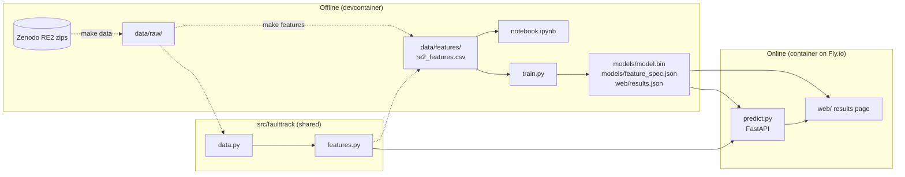
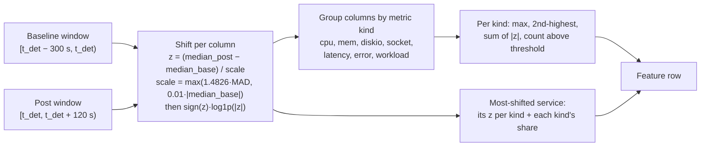
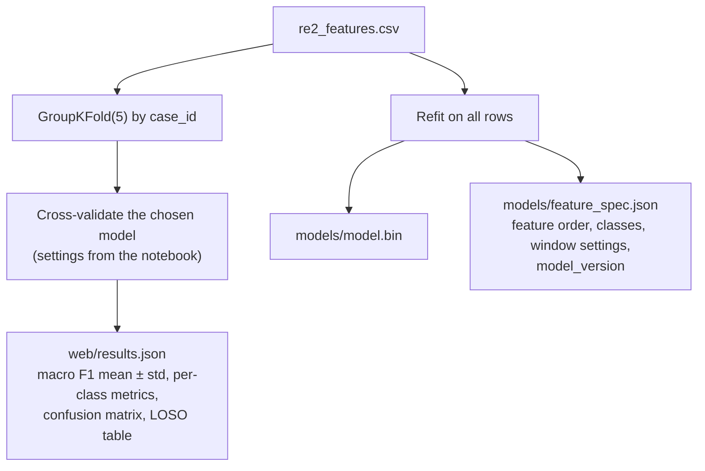
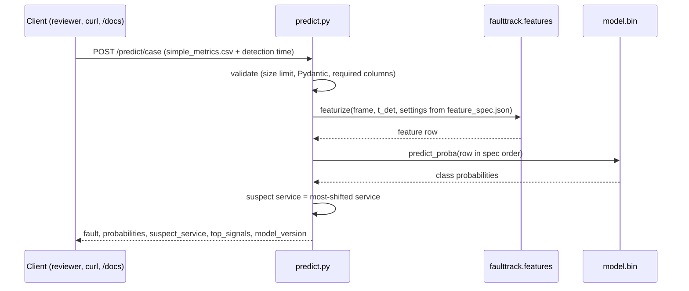
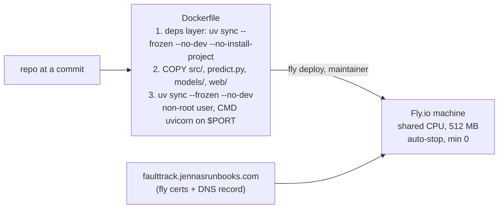

# Architecture

This page covers how FaultTrack is put together:
- the data pipeline
- feature computation
- training
- serving
- deployment
- CI

What to build and why is in [`product-spec.md`](../product-spec.md), and working rules are in [`AGENTS.md`](../AGENTS.md). Agents and reviewers should read this page before changing code that crosses module boundaries.

> **Status:** this is the target design for the graded build (spec Section 10). Feature names, model settings and the results figures listed here are fixed in `models/feature_spec.json` and `web/results.json` once `train.py` exists. Where this page and those files disagree, the files win, and this page gets corrected.

## Overview

The dashed steps need the 4 GB raw download. Everything from `re2_features.csv` onward runs from committed files.

## Module boundaries

| Layer | Rule |
|---|---|
| `src/faulttrack/data.py` | The only code that knows the RCAEval folder layout and its quirks (spec 3.3). It returns a tidy metrics `DataFrame` (one `time` column + `<service>_<kind>` columns), the injection time, and the label. No feature logic |
| `src/faulttrack/features.py` | The only code that computes features. It's a pure function of (metrics `DataFrame`, detection time, settings) and does no file I/O. It's used by `make features`, `train.py`, the notebook and `predict.py` |
| `notebook.ipynb` | Reads `re2_features.csv`. It may plot raw cases for EDA through `data.py`, but never re-implements features |
| `train.py` | Reads `re2_features.csv`, fits the final model with the settings chosen in the notebook, and writes the artifacts. It doesn't download anything |
| `predict.py` | Loads the artifacts once at startup. It handles HTTP only and calls `features.py` for raw cases. It has no training code |
| `spike/` | Go/no-go scripts. Graded code never imports from it |

**Tests:**
- **Unit tests** cover `data.py` quirks and `features.py` math against small synthetic frames.
- **The parity test** runs one real fixture case (`tests/fixtures/`) through `features.py` the way `/predict/case` does, and asserts the result equals that case's row in `re2_features.csv`.
- **API tests** use FastAPI's `TestClient`.
- No test needs `data/raw/` or the network.

## Data pipeline

| Stage | Code | Input | Output |
|---|---|---|---|
| Download | `make data` → `spike/download_rcaeval.sh` | Zenodo record 14590730 | `data/raw/RE2-{OB,SS,TT}/…/<service>_<fault>/<n>/` with `simple_metrics.csv`, `inject_time.txt` (logs and traces aren't extracted) |
| Discover cases | `data.find_cases()` | `data/raw/` | One entry per case: system, service, fault, repetition, path. Cases without `simple_metrics.csv` are skipped with a stderr message (RE2-OB has one: `checkoutservice_cpu/4`) |
| Load | `data.load_case()` | One case folder | Metrics frame. `inf` becomes NaN, then forward-fill, then 0. The repeated `time.1` header column is dropped, and `latency-50` is ignored |
| Featurise | `features.featurize()` | Metrics frame + detection time | One feature row |
| Build table | `make features` | All cases × 5 detection delays | `data/features/re2_features.csv` (about 1,350 rows) |

## Feature computation

For one case and one detection time `t_det` (the injection time plus a detection delay of 0, 30, 60, 90 or 120 s):

**Design notes:**
- **The features are service-agnostic.** Columns are grouped by metric *kind*, never by service name, so one model covers systems with 11, 15 or 68 services.
- **Scale floor and log compression.** Without them, near-constant metrics (memory) get huge z-scores that hide everything else. In the go/no-go spike, adding them took logistic regression on RE2-OB from 0.54 to 0.85 macro F1.
- **Missing kinds are 0, not NaN.** Some services don't export `diskio`, `latency` or `error`. A kind with no columns gets 0 for every aggregate. This is a known blind spot for disk faults: in RE2-OB, only 2 of the 5 disk-fault services expose `diskio`.
- **Row identity columns:** `case_id`, `system`, `service`, `fault` (label), and `delay_s`. These are never model inputs. `case_id` is the CV group.

## Training

| Artifact | Contents | Used by |
|---|---|---|
| `models/model.bin` | The fitted classifier, pickled | `predict.py` |
| `models/feature_spec.json` | Ordered feature names, class labels, the baseline and post window lengths, the scale floor, `model_version` (for example `2026.11.10-rf`) | `predict.py` (validates input and builds the vector in order), parity test |
| `web/results.json` | Evaluation figures written by `train.py` | the results page at `/` |

**Evaluation rules (spec Section 5):**
- **Splits:** grouped CV by case only. Each case contributes 5 rows, so a row-level split would leak.
- **Headline:** grouped 5-fold CV across all three systems, reported as mean ± std (min/max).
- **Generalisation:** leave-one-system-out is a separate section.

## Serving

| Endpoint | Input | Output | Errors |
|---|---|---|---|
| `GET /` | none | Static results page (`web/index.html` + `results.json`) | none |
| `POST /predict` | JSON feature vector (names from `feature_spec.json`) | Prediction JSON (spec Section 6) | 422: missing or unknown features |
| `POST /predict/case` | Multipart: `simple_metrics.csv` + `detection_time` (Unix seconds) | Prediction JSON with `suspect_service` | 413: file too large · 422: bad input, or the window falls outside the file · 400: no usable metric columns (for example a raw `metrics.csv`) |
| `GET /healthz` | none | `{"status": "ok", "model_version": …}` | none |
| `GET /docs` | none | Swagger UI | none |

**Runtime behaviour:**
- **Startup:** the model and spec load once at startup. If either is missing, the app exits instead of serving errors.
- **State:** the app holds no state and writes nothing to disk. Uploads are read in memory, subject to the size limit.
- **Port:** the app listens on `$PORT` (default 8080).

## Root-cause rule

`suspect_service` comes from a rule, not a model. It's the service with the largest total shift across kinds in the detection window. On the go/no-go spike it named the injected service in 85% of cases across the three systems. A trained ranking model is stretch work.

## Deployment

**Cold starts:** the machine stops when idle, so the first request after a quiet period takes a few seconds while it starts. Later requests are fast.

## CI

**When it runs:** `.github/workflows/ci.yaml` runs on every PR and on every push to `main`.

**Jobs:** a `changes` job decides which of `lint`, `test` and `docker` run. It's a shell step: `git diff --name-only` against the PR base, matched with `grep -E`, with no third-party filter action. On PRs, a job is skipped when none of its files changed. Pushes to `main`, `workflow_dispatch`, and PRs with the `full-ci` label run everything.

**Gate:** `ci-ok` is the single required check. It passes when every other job either passed or was skipped. Path rules are in the spec's PR CI design table.

**Dependabot:** `dependabot.yaml` covers `uv`, `github-actions` and `docker`. Its PRs go through the same CI.

## Where things are decided

| Question | Answer lives in |
|---|---|
| What to build, by when | `product-spec.md` |
| Why a modelling or evaluation choice was made | `docs/decisions.md` |
| Exact feature list and model settings | `models/feature_spec.json` |
| Current results | `web/results.json`, the README "Results" section |
| Who may change what | `docs/permissions.md`, `docs/agent-team.md` |
