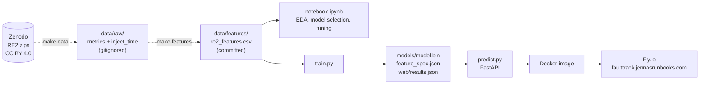
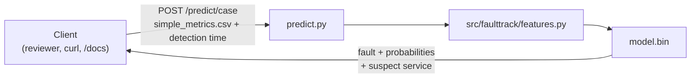

# FaultTrack: product specification

**Status:** GO (decided Nov 3, 2026). Building the graded midterm version.
**Course:** DataTalksClub ML Zoomcamp 2026, midterm project
**Due:** **16 November 2026 (Mon), 17:00**.
**Repo:** `jennasrunbooks/faulttrack` · **License:** Apache-2.0 for code. The data and derived data are CC BY 4.0 (see [Data](#3-data)).

---

## 1. Summary

**One-liner:** *FaultTrack looks at the metrics around an alert and tells on-call what kind of fault it probably is (CPU, memory, disk, socket, network delay or packet loss) and which service it most likely started in, before anyone opens a dashboard.*

**Problem.** When an alert fires in a microservice system, the first minutes go on working out *what kind* of problem it is and *where* it started. Is it resource exhaustion on one service, or a network problem slowing down every service that sends requests to the affected one? The answer decides who gets paged and which runbook to open.

**Solution.**
1. **Features:** turn the per-service Prometheus metrics in a window around the alert into service-agnostic features (how far each metric type moves after the alert, compared with a baseline before it).
2. **Prediction:** classify the fault type with a tuned tree-based model, and name the service that moved most.
3. **Serving:** a FastAPI service, deployed to the cloud.

**Users:** on-call SREs and platform engineers triaging microservice incidents.

### Goals (graded midterm version)

- **Fault-type classifier:** 6 classes (`cpu`, `mem`, `disk`, `socket`, `delay`, `loss`), trained on RCAEval RE2 metrics.
- **Honest evaluation:** CV grouped by case, with the spread across folds reported. Generalization to an unseen system is analyzed separately.
- **A suspected root-cause service** reported with every prediction (most-anomalous-service rule).
- **Every deliverable and rubric criterion met for 16/16** (Section 9).

### Non-goals (for the graded version)

- **No logs or traces.** RE2's raw logs and traces run to millions of lines per case. They're stretch work only (Section 11).
- **No live Prometheus or Alertmanager integration, no Kubernetes or Helm, no EKS.** All stretch, after submission.
- **No claim of production accuracy on a new cluster.** The cross-system results show a domain-shift gap, which is documented, not hidden.

---

## 2. Course rules that constrain the build

- **Deliverables live at the repo root:**
  - `README.md` (problem + how to run)
  - data, committed or with clear download instructions
  - `notebook.ipynb` (prep, EDA, feature importance, model selection and tuning)
  - `train.py` (trains the final model and saves it)
  - `predict.py` (loads the model and serves it as a web service)
  - dependency files
  - `Dockerfile`
  - a deployment URL, or a video or screenshot of the deployed service in use
---

## 3. Data

### 3.1 Source and license

- **Dataset:** RCAEval (Pham et al., *RCAEval: A Benchmark for Root Cause Analysis of Microservice Systems with Telemetry Data*, WWW 2025 Companion).
- **Copy used:** Zenodo record https://zenodo.org/records/14590730 (DOI `10.5281/zenodo.14590730`), license **CC BY 4.0**. Re-use and redistribution are allowed with credit and an indication of changes.
- **The Zenodo copy is the one we use;** the Hugging Face copy isn't.
- **Credit:** cite the paper and the DOI in the README. Derived files carry `data/features/ATTRIBUTION.md`.

### 3.2 What we use

**RE2:** 3 systems, Online Boutique (OB), Sock Shop (SS) and Train Ticket (TT), × 6 faults × 5 services × 3 repetitions = **270 cases**, 15 per fault per system.

| Suite | Zip (download) | md5 (verified) |
|---|---|---|
| RE2-OB | https://zenodo.org/records/14590730/files/RE2-OB.zip?download=1 (~1.1 GB) | `b9e23f8842c404b396ffd2becff15de4` |
| RE2-SS | https://zenodo.org/records/14590730/files/RE2-SS.zip?download=1 | check against the Zenodo page |
| RE2-TT | https://zenodo.org/records/14590730/files/RE2-TT.zip?download=1 | check against the Zenodo page |

**Case layout (confirmed):** `RE2-XX/RE2-XX/<service>_<fault>/<n>/` contains:

- **`simple_metrics.csv`:** 1,441 rows at 1 s (24 min), with the fault injected at the midpoint. Per service: `cpu`, `mem`, `socket`, `workload`, `latency-50`, `latency-90`, `diskio`, `error`. **The features are built from this file.**
- **`metrics.csv`:** the raw Prometheus export, about 420 columns. Per-container `container-cpu-*`, `container-memory-*`, `container-fs-*`, `container-blkio-*`, `container-sockets` and `container-network-*` (bytes, packets, **dropped**, **errors**), plus `istio-*` and `node-*`. Most are cumulative counters. **Not used in the graded version.**
- **`inject_time.txt`:** Unix seconds.
- **Label:** taken from the folder name (`<service>_<fault>`).

### 3.3 Known quirks (handled in `src/faulttrack/data.py`)

- **RE2-OB has 91 cases:** `checkoutservice_cpu/4` has no `simple_metrics.csv` and is skipped, leaving 90.
- **Raw-only cases** (no `simple_metrics.csv`) are skipped with a message, never silently featurized.
- **Naming:** Train Ticket names are prefixed `ts-`, and Sock Shop's frontend is `front-end`.
- **Gaps and `inf` values:** replace `inf` with NaN, forward-fill, then fill with 0. Drop any `time.1` column (a repeated-header quirk in some suites).
- **p90 latency only:** `latency-50` is ignored, as in RCAEval's own baselines.

### 3.4 Size per system

| | OB | SS | TT |
|---|---|---|---|
| `simple_metrics.csv` columns | 72 | 78 | 369 |
| Services with cpu / mem / socket | 11 | 15 | 68 |
| …with `diskio` | 5 | 9 | 67 |
| …with latency | 10 | 7 | 28 |

### 3.5 Data handling in the repo

- **Raw data:** `data/raw/` is **gitignored**. `make data` downloads it from Zenodo and extracts metrics only.
- **Derived feature table:** `data/features/re2_features.csv` (about 1,350 rows) is **committed**, with `ATTRIBUTION.md`, so reviewers can run the notebook and `train.py` without the 4 GB download. `make features` regenerates it.

---

## 4. Features

For each metric kind (`cpu`, `mem`, `diskio`, `socket`, `latency`, `error`, `workload`) and each service:

1. **Shift score:**
   - `z = (median(post window) − median(baseline)) / scale`
   - `scale = max(1.4826·MAD(baseline), 0.01·|median(baseline)|)`, with a std fallback
   - The baseline is the 300 s before detection; the post window is 120 s.
2. **Log compression:** `sign(z)·log1p(|z|)`. Without it, flat metrics (memory) saturate and hide magnitude.
3. **Aggregation across services, per kind:** max, 2nd-highest, sum of |z| and count above threshold. Optionally per-service means and fractions instead (`--norm-counts`).
4. **The profile of the most anomalous service:** its shift for each kind, and each kind's share of its total.

**Rows:** 5 windows per case, at detection delays of 0, 30, 60, 90 and 120 s, giving **1,350 rows**. **CV is always grouped by case**, so windows from one case never end up in both train and test.

**Training/serving parity:** `train.py` and `predict.py` import the **same** `src/faulttrack/features.py`. A unit test checks that features computed by the API for a fixture case equal the training row exactly.

---

## 5. Modelling and evaluation

### 5.1 Models

Compare all of these on the same grouped folds, and tune each:

| Model | Role | What to tune |
|---|---|---|
| Dummy (majority class) | floor | none |
| Rule baseline ("the metric kind with the biggest shift wins") | ML vs. rule-based (module 1) | none |
| Multinomial logistic regression | linear model + coefficient interpretation | `C` |
| Decision tree (depth 3–4) | the **on-call runbook** plot | `max_depth`, `min_samples_leaf` |
| Random forest | ensemble | `n_estimators`, `max_depth`, `min_samples_leaf` |
| XGBoost | gradient boosting | `eta`, `max_depth`, `min_child_weight`, `n_estimators`, early stopping |

**The final model** is chosen on grouped-CV macro F1, accounting for the fold spread.

### 5.2 Evaluation (README "Results")

- **Headline:** grouped 5-fold CV across all three systems. Report macro F1 as **mean ± std (min/max) across folds**, against the dummy and rule baselines. With about 45 cases per class, a single pooled score overstates certainty.
- **Also reported:**
  - per-class precision, recall and F1, plus the confusion matrix, with written explanations of the main confusions
  - one-vs-rest ROC AUC
  - F1 against detection delay (0 / 30 / 60 / 120 s)
  - the root-cause service hit rate of the no-ML most-anomalous-service rule
  - feature importance: XGBoost gain, permutation importance, and the depth-3 tree
- **"Generalizing to an unseen system":** leave-one-system-out results (train on two systems, test on the third), the system-size diagnostic, the `--norm-counts` experiment, and the relative-features experiment if done. Presented as a limitation, with analysis.

### 5.3 Evidence from the go/no-go spike (Nov 2–3)

These numbers come from the spike scripts (`spike/`), not from tuned final models.

| Run | Result |
|---|---|
| RE2-OB only, raw z | RF 0.704 ± 0.097 · XGB 0.647 · LR 0.543 · majority 0.048 |
| RE2-OB only, floor + log z | XGB **0.917 ± 0.076** · HGB 0.906 · RF 0.900 · LR 0.847 |
| **All 3 systems, grouped 5-fold** | **RF 0.828 ± 0.039** (min 0.769, max 0.875) · XGB 0.820 · HGB 0.819 · LR 0.673 · majority 0.048 |
| Root-cause rule (no ML), 3 systems | **0.853** |
| Leave-one-system-out, HGB | OB 0.521 · SS 0.275 · TT 0.296 · mean **0.364 ± 0.112** |
| Leave-one-system-out, HGB, `--norm-counts` | mean 0.335 ± 0.118 (LR on TT 0.13 → 0.35) |

**Findings that go into the README:**

1. **Feature scaling mattered more than model choice.** On RE2-OB, logistic regression went from 0.54 to 0.85 with the same features once a scale floor and log compression were added.
2. **Delay vs. loss isn't the hardest pair within one system** (about 0.89 F1 each). Across systems it's the main confusion (about 30 cases each way).
3. **Disk faults often lack direct telemetry.** In RE2-OB only 2 of the 5 disk-fault services have `diskio`, so disk stress shows up as memory (page cache) and CPU.
4. **`error` almost never shifts.** Only a few frontend services expose it, so loss vs. delay relies mostly on latency.
5. **Generalization gap:** about 0.83 when systems are mixed, but about 0.35 on an unseen system. System size explains only part of it; the rest is domain shift (the same fault has different magnitudes and spread in each system).

---

## 6. Serving

**`predict.py`**, a FastAPI app with Pydantic validation, serves:

- **`GET /`:** a static results page from `web/` (`index.html` + `results.json` written by `train.py`): headline results, the confusion matrix, sample held-out cases, and the runbook tree.
- **`POST /predict`:** takes a feature vector and returns fault probabilities plus the top contributing features.
- **`POST /predict/case`:** takes a raw case (a `simple_metrics.csv` upload plus the detection time) and builds the features with the shared code. It returns the prediction and the suspected service.
- **`GET /healthz`** and **`GET /docs`** (Swagger UI, for reviewers).

Example response:

```json
{
  "fault": "loss",
  "probabilities": {"loss": 0.62, "delay": 0.27, "cpu": 0.04, "mem": 0.03, "disk": 0.02, "socket": 0.02},
  "suspect_service": "cartservice",
  "top_signals": ["latency_max", "top_latency_share", "workload_max"],
  "model_version": "2026.11.10-rf"
}
```

**Deployment:**
- **Host:** Fly.io, at `https://faulttrack.jennasrunbooks.com`.
- **Machine:** shared CPU, 512 MB, auto-stop, `min_machines_running = 0`.
- **Port:** the app listens on `$PORT` (default 8080).
- **Domain:** `fly certs add` plus DNS records at the `jennasrunbooks.com` DNS host.
- **Evidence for reviewers:** screenshots or a short video.

---

## 7. Architecture and repo layout

**Data and model flow.** The flow starts at the Zenodo download and ends at the live service. Reviewers can skip the dashed part (the 4 GB download) and start at the committed feature table.



**Request flow.** `/predict/case` uses the same `src/faulttrack/features.py` as training, so features can't drift between the two.



```
faulttrack/                 # repo root (jennasrunbooks/faulttrack)
├── README.md               # problem, data + credit, EDA highlights, results, how to run, rubric map
├── REVIEWING.md            # peer-review guide: review paths, criterion-by-criterion evidence + checks
├── AGENTS.md               # coding-agent rules + commands; points here
├── product-spec.md         # this file
├── LICENSE                 # Apache-2.0 (code)
├── notebook.ipynb          # course deliverable (root); the only notebook
├── train.py                # course deliverable (root)
├── predict.py              # course deliverable (root): FastAPI app
├── Makefile                # data, features, train, serve, test, lint, docker-build, docker-run, deploy
├── pyproject.toml, uv.lock, .python-version
├── data/
│   ├── README.md           # download + checksums + extraction
│   ├── raw/                # gitignored
│   └── features/
│       ├── re2_features.csv
│       └── ATTRIBUTION.md
├── src/
│   └── faulttrack/         # Python package (src layout), installed into the venv by uv sync
│       ├── __init__.py
│       ├── features.py     # shared feature code: `from faulttrack import features` in train.py + predict.py
│       └── data.py         # case discovery + loading + quirks
├── docs/
│   ├── images/             # README figures + deployment screenshots (cloud-deployment evidence)
│   ├── architecture.md     # pipeline, module boundaries, artifacts, serving, deployment, CI
│   ├── permissions.md      # controls per actor (agents, CI, runtime, hosting) + accepted gaps
│   ├── agent-team.md       # roles, issue → PR flow, parallel-agent rules, access
│   ├── decisions.md        # go/no-go record + later design decisions, dated
│   └── proposed-workflows/ # agent-proposed .github/ files + README; a human moves them
├── spike/                  # go/no-go scripts (download, EDA, spike); exploratory, not graded
├── scripts/gh/             # maintainer-run gh scripts: labels.sh (labels + milestone), issues
├── models/                 # model.bin, feature_spec.json (committed; small)
├── web/                    # static results page served at /
├── tests/                  # feature parity, API smoke test; tests/fixtures/ = one small real case
├── .devcontainer/          # devcontainer.json + Dockerfile (dev environment)
├── .github/
│   ├── workflows/ci.yaml   # path-aware lint, tests, image build on PRs
│   └── dependabot.yaml     # weekly grouped updates: uv, github-actions, docker
├── Dockerfile              # service image: deps layer, then copy src/ + install the package
└── fly.toml
```

---

## 8. Development environment

**Python work happens in the devcontainer** (Linux, Python 3.12, uv). Docker builds, `fly deploy`, DNS and the submission tag happen on the Mac host, because the container has no Docker and no deploy credentials.

| Task | Command (devcontainer, repo root) |
|---|---|
| Install / sync | `uv sync` (also runs on container create) |
| Add a dependency | `uv add <pkg>` (runtime) · `uv add --dev <pkg>` (notebook, EDA, tests) |
| Download data | `make data` (wraps `spike/download_rcaeval.sh`, using `KEEP_ZIPS=0`) |
| Build features | `make features` |
| Train | `uv run python train.py` |
| Serve locally | `uv run uvicorn predict:app --port 8080` |
| Lint / format | `uv run ruff check --fix .` · `uv run ruff format .` |
| Tests | `uv run pytest` |

**Rules:**
- **Never run `uv` on the Mac against the repo's `.venv`.** It contains Linux binaries. Mac runs, if any, use `UV_PROJECT_ENVIRONMENT=.venv-mac` and `uv sync --frozen`.
- **Package layout:** `src/faulttrack/`. `pyproject.toml` has a `[build-system]` (hatchling: `requires = ["hatchling"]`, `build-backend = "hatchling.build"`), so `uv sync` installs `faulttrack` into `.venv` as an editable package. Root scripts then `import faulttrack` with no `sys.path` tricks. Tests run against the installed package, which catches packaging mistakes early.
- **Tool settings live in `pyproject.toml`:** `[tool.ruff]` (line length 88; rules E4, E7, E9, F, I, B, UP) and `[tool.pyright]` (`venvPath = "."`, `venv = ".venv"`, `typeCheckingMode = "standard"`). basedpyright reads `[tool.pyright]`, so don't also add a `[tool.basedpyright]` section (having both is an error).
- **Runtime vs. dev dependencies:**
  - **runtime:** pandas, numpy, pyarrow, scikit-learn, xgboost, fastapi, uvicorn, python-multipart (file uploads for `/predict/case`)
  - **dev:** matplotlib, jupyter, ipykernel, ruff, basedpyright, pytest, httpx. basedpyright is a Pyright fork on PyPI that ships Node as a wheel (`nodejs-wheel-binaries`), so type checking never downloads anything at run time.

---

## 9. Grading rubric (16 points) and how we meet it

| Criterion | Max | Full marks means | Where in this repo | Done |
|---|---|---|---|---|
| Problem description | 2 | README explains the problem and how the solution will be used | `README.md`: Problem, Users, How it's used | ☐ |
| EDA | 2 | Ranges, missing values, target analysis, feature importance | `notebook.ipynb` §2–3: per-fault signatures, disk telemetry gap, system-size table, mutual information, correlation | ☐ |
| Model training | 3 | Multiple models (linear **and** tree-based) **and** tuned | `notebook.ipynb` §4–5: LR, DT, RF, XGBoost, tuned with grouped CV | ☐ |
| Exporting notebook to script | 1 | Training logic in a script | `train.py` | ☐ |
| Reproducibility | 1 | Notebook and script re-run; data accessible | committed `data/features/re2_features.csv` + `make data`; fresh-clone check | ☐ |
| Model deployment | 1 | Served with Flask, FastAPI or similar | `predict.py` (FastAPI) | ☐ |
| Dependency and environment management | 2 | Dependency file **and** venv, plus README on install and activation | `pyproject.toml` + `uv.lock`; README "Setup" | ☐ |
| Containerization | 2 | Dockerfile **and** README on build and run | `Dockerfile`; README "Docker" | ☐ |
| Cloud deployment | 2 | Deployment code **and** a test URL or video/screenshot | `fly.toml` + README "Deploy"; `https://faulttrack.jennasrunbooks.com`; screenshots in `docs/images/` | ☐ |

---

## 10. Plan to 16 November 2026

**`ws-<n>`** means *workstream n*, the plan line number in the `#` column below. It's used in branch names (`ws-4-features`) and issue titles (`ws-4: shared library and feature table`) to tie work back to this table.

Mark the **Status** column `Done` (with the date) as each line completes. Working cadence: daily, with 1 day off per week (2 at most).

| # | Workstream | Deliverables | Target date | Status |
|---|---|---|---|---|
| 1 | Go/no-go | Data downloaded and verified (md5); EDA; spike on all 3 systems; decision logged | Tue Nov 3 | Done (Nov 3) |
| 2 | Repo access | `jksprattler-agent` fine-grained PAT scoped to `jennasrunbooks/faulttrack`; `dev-agent` env updated | Tue Nov 3 | ☐ |
| 3 | Repo scaffold | `product-spec.md`, `AGENTS.md`, `LICENSE`, `.gitignore`, `.devcontainer/`, `pyproject.toml` (deps + `[build-system]` + ruff + pyright), `src/faulttrack/__init__.py`, `uv.lock`, `Makefile` skeleton, `data/README.md`, `data/features/ATTRIBUTION.md`; **PR CI** `.github/workflows/ci.yaml`, path-aware (see below); branch protection on `main` requiring the single `ci-ok` check; `.github/dependabot.yaml` + Dependabot security alerts on (see below) | Wed Nov 4 | ☐ |
| 4 | Shared library | `src/faulttrack/data.py` + `features.py` ported from `spike/`; parity test fixture; `make data`, `make features`; committed `re2_features.csv` | Thu Nov 5 | ☐ |
| 5 | Notebook: prep + EDA | Data prep, quirks, class balance, per-fault signature plots, disk telemetry gap, scaling before/after, system-size table, mutual information + correlation | Sat Nov 7 | ☐ |
| 6 | Notebook: models | Dummy, rule baseline, LR, DT (runbook), RF, XGBoost; grouped CV with tuning; per-class metrics; confusion matrix; ROC AUC; detection-delay curve; final model choice | Mon Nov 9 | ☐ |
| 7 | Generalization analysis | Leave-one-system-out; `--norm-counts`; relative-features experiment (time-boxed to half a day); write-up | Tue Nov 10 | ☐ |
| 8 | `train.py` | Trains the final model; writes `models/model.bin`, `feature_spec.json`, `web/results.json` | Tue Nov 10 | ☐ |
| 9 | `predict.py` + tests | FastAPI `/`, `/predict`, `/predict/case`, `/healthz`; Pydantic models; parity + API smoke tests | Thu Nov 12 | ☐ |
| 10 | Containerization | CI `docker` job builds the service image when image inputs change (build only, no push); service `Dockerfile` (two steps: `uv sync --frozen --no-dev --no-install-project` for a cached dependency layer, then `COPY src/` + `uv sync --frozen --no-dev` to install the package; `$PORT`); `make docker-build` / `docker-run`; local test on the Mac | Thu Nov 12 | ☐ |
| 11 | Cloud deployment | Fly.io app; `fly.toml`; `faulttrack.jennasrunbooks.com` (certs + DNS); screenshots or video | Fri Nov 13 | ☐ |
| 12 | README + results page | Problem, data + credit, EDA highlights, results, generalization section, setup / run / Docker / deploy, rubric map; `web/index.html`; `REVIEWING.md` links and commands checked, "Numbers" table filled in line 13 | Sat Nov 14 | ☐ |
| 13 | Reproducibility check | Fresh clone in a new devcontainer: `make features` → notebook → `train.py` → `predict.py` → Docker → live URL; fix anything that breaks | Sun Nov 15 | ☐ |
| 14 | **Submit** | On `main`: `git switch main && git pull`, `git tag -a midterm-submission -m "ML Zoomcamp 2026 midterm submission"`, `git push origin midterm-submission`; publish it as a GitHub release; submit the tag URL on the course platform | **Mon Nov 16, before 17:00** | ☐ |
**PR CI design (`ci.yaml`).** Jobs run only when the files they check change, so a docs-only PR finishes in seconds:

| Job | Runs when the PR touches | Does |
|---|---|---|
| `changes` | always | A shell step: `git diff --name-only` against the PR base, matched with `grep -E` patterns, writes one `true`/`false` output per job to `$GITHUB_OUTPUT`. No third-party filter action |
| `lint` | `**/*.py`, `*.ipynb`, `pyproject.toml` | `ruff check`, `ruff format --check` |
| `test` | `src/**`, `tests/**`, `train.py`, `predict.py`, `pyproject.toml`, `uv.lock`, `data/features/**`, `models/**` | `uv sync --frozen`, `pytest` |
| `docker` | `Dockerfile`, `src/**`, `predict.py`, `pyproject.toml`, `uv.lock`, `models/**`, `web/**` | `docker build` (no push) |
| `ci-ok` | always, after the others | passes if every job passed or was skipped; this is the **only required check** |

- **Pushes to `main` run every job.** That catches anything a path filter missed.
- **`full-ci` label:** adding it to a PR runs every job, whatever changed. The workflow triggers on `pull_request` types `opened`, `synchronize`, `reopened`, `labeled` and `unlabeled`. `workflow_dispatch` runs everything on demand.
- **Other settings:** `concurrency` cancels superseded runs on the same PR, and `astral-sh/setup-uv` caches the uv download cache.
- **Why job-level skips:** don't put a top-level `paths:` filter on the workflow. If the whole workflow is skipped, its required checks never report, and the PR can't merge. Instead the workflow always starts, and individual jobs are skipped with `if:`. GitHub counts a skipped job as passing for a required check. ConsoleTrack uses the same pattern.
- **Why `ci-ok`:** it gives branch protection one stable check name, so adding or renaming jobs never means editing branch protection. It runs with `if: always()` and fails if any job in its `needs:` failed or was cancelled.
- **`do-not-merge` label:** `ci-ok` also fails while the PR carries this label, so branch protection blocks the merge. The workflow triggers on `labeled` and `unlabeled`, so `ci-ok` re-runs as soon as the label is added or removed.

**Dependabot (package hygiene).**

| Ecosystem | Directory | What it updates |
|---|---|---|
| `uv` | `/` | `pyproject.toml` + `uv.lock` |
| `github-actions` | `/` | action versions in `ci.yaml` |
| `docker` | `/` and `/.devcontainer` | base images in both Dockerfiles |

- **Schedule:** weekly. Minor and patch updates are **grouped** into one PR per ecosystem, so there's less noise. Major updates come as separate PRs.
- **Security updates** (Settings → Advanced Security): on. They open PRs immediately for known CVEs, regardless of the schedule.
- **CI:** Dependabot PRs go through the same path-aware CI. A `uv.lock` change triggers `test` and `docker`.

**Buffer:** lines 7 and 12 are the flexible ones. If the schedule slips, cut the relative-features experiment (line 7) first, and never cut lines 5, 6, 12 or 13.

---

## 11. Risks

| Risk | Mitigation |
|---|---|
| Schedule (deadline Nov 16, 17:00) | Plan above; stretch work only after submission; cut line 7 first |
| A reviewer can't reproduce | Committed feature table; pinned `uv.lock`; fresh-clone check (line 13); README tested step by step |
| Overstated results (small data: about 45 cases per class) | Report fold spread; grouped CV; separate generalization section |
| Domain shift to unseen systems | Documented as a limitation with analysis; not claimed away |
| Training/serving skew | One shared `features.py`; parity test |
| Plagiarism rules | All code written for this repo; no application code copied from other projects; dataset credited |
| Fly.io cost or trial expiry | Sign up when deploying (line 11); scale to zero; a few $/month |

---

## 12. Stretch (after the Nov 16 deadline)

- **Raw-metric features from `metrics.csv`:**
  - `container-fs-*` and `container-blkio-*` for disk
  - network packets dropped and errors, plus `istio-error-total`, for loss vs. delay
- **Relative features**, if not done in line 7.
- **Helm chart + Helmfile on kind** with kube-prometheus-stack, Loki, Tempo and OTel, plus model-ops metrics (`faulttrack_predictions_total{fault}`, `faulttrack_inference_seconds`, `faulttrack_feature_drift{feature}`) and a Grafana dashboard.
- **`/alerts` Alertmanager webhook**, with a PromQL adapter per metric kind.
- **CI/CD in GitHub Actions** (beyond the PR checks in lines 3 and 10):
  - push the image to GHCR on merge to `main`, tagged with the commit SHA
  - deploy to Fly.io from a workflow on a release tag, with `FLY_API_TOKEN` as a repo secret and a manual approval environment
  - post-deploy smoke test: `/healthz` and a sample `/predict/case` against the live URL
  - kind smoke test for the Helm chart once it exists
  - pin actions to commit SHAs (Dependabot keeps them updated)
- **Long-term hosting on AWS:** CloudFront + S3 + Lambda (same container, via the Lambda Web Adapter), Terraform with `ft-` resource names, at about $0/month. Then retire Fly.io.
- **Logs and traces:** start with the pre-aggregated series; avoid the raw ones.

---

## 13. Working rules for coding agents

These also go into `AGENTS.md`.

- **Read this spec before starting any workstream.** Implement only what the current workstream (Section 10) needs, and don't start stretch items before line 14 (submission).
- **Branches:**
  - **Before submission:** work on branches named `ws-<n>-<short-name>` (e.g. `ws-4-features`) and open pull requests against `main`. The maintainer reviews and merges.
  - **After submission:** never move or delete the `midterm-submission` tag (a tag ruleset enforces this).
- **Code rules:**
  - Write all code fresh for this repo. **Don't copy code** from other projects, other students or prior course iterations.
  - Keep the course deliverables at the repo root (`train.py`, `predict.py`, `notebook.ipynb`, `Dockerfile`, `README.md`).
  - `features.py` is shared by training and serving. **Any change to it must keep the parity test green.**
- **Data rules:**
  - Never commit `data/raw/`, zips, `.venv*`, `.vscode/` or credentials.
  - Only `data/features/re2_features.csv` (with `ATTRIBUTION.md`) is committed data.
- **Environment:**
  - Run Python only via `uv run …` in the devcontainer.
  - Change dependencies only with `uv add` / `uv remove`, and commit `pyproject.toml` + `uv.lock` together.
- **Before opening a PR:** `uv run ruff check .` and `uv run pytest` both pass, and `make typecheck` (basedpyright) shows no errors in changed files. CI runs the same checks, and a PR merges only when CI is green.
- **Dependabot PRs** are reviewed and merged by the maintainer. The agent doesn't merge or rebase them.
- **Workflow files:** the agent's PAT has no `Workflows` permission, so changes to `.github/workflows/` are made by the maintainer. The agent puts proposed files in `docs/proposed-workflows/<name>.yaml` and says so in the PR.
- **Results:** report metrics as mean ± std across folds, with grouped CV. Never use random row-level splits (windows from one case would leak).
- **No deployment from the agent.** Deploys, DNS and tags are done by the maintainer from the host.

---

## 14. Open questions

- **md5 sums for RE2-SS and RE2-TT:** check them against the Zenodo record, and fill them into Section 3.2.
- **Final model:** RF or XGBoost, decided in workstream 6.
- **Relative features:** include them in the graded version, or keep them as stretch? Decided by workstream 7's result.